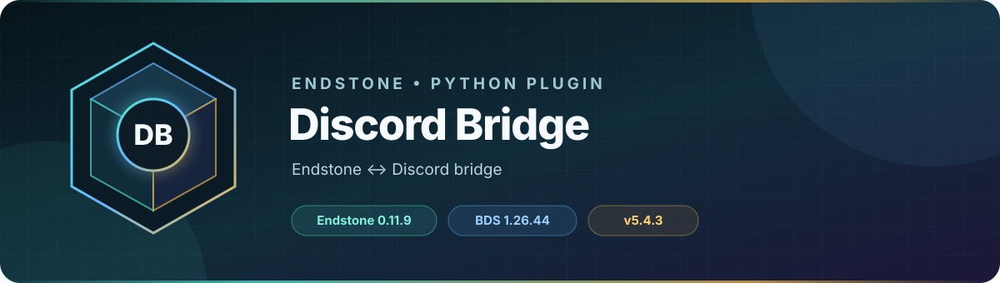

<!-- endstone-professional-header:start -->
<p align="center">
  
</p>

<p align="center">
  <a href="https://github.com/TheNINJALLO/endstone-discord-bridge/actions/workflows/wheel-release.yml"></a>
  <a href="https://github.com/TheNINJALLO/endstone-discord-bridge/releases/latest"></a>
</p>

<p align="center">
  
  
  
  =3.11" src="https://img.shields.io/badge/Python-%3E=3.11-3776AB?style=flat-square&amp;logo=python&amp;logoColor=white">
</p>

<p align="center">
  <strong>Endstone ↔ Discord bridge.</strong>
</p>

<p align="center">
  <a href="#what-it-does">What it does</a> &bull;
  <a href="#how-to-use">How to use</a> &bull;
  <a href="#commands-and-permissions">Commands</a> &bull;
  <a href="#install">Install</a> &bull;
  <a href="https://github.com/TheNINJALLO/endstone-discord-bridge/releases">Releases</a>
</p>

## Overview

Endstone ↔ Discord bridge. This release uses the Endstone 0.11 API, supports the Endstone 0.11.15 / BDS 1.26.60.6 runtime, and is distributed as a Python wheel for direct installation in an Endstone server.

## What it does

- Relays Minecraft chat and server activity to Discord and supports Discord-to-server messaging.
- Links Minecraft and Discord identities, routes queued commands, and can report grief/economy/activity events.
- Offers Discord slash-command administration plus two focused in-game commands.

## How to use

1. Copy the example configuration to the plugin data folder and provide the bot token, guild ID, and channel/role IDs only in that local runtime file.
2. Invite the bot with the required Discord permissions, start Endstone, and confirm that slash commands synchronize.
3. A player runs `/link`, then completes the generated code with `/verify` in Discord.
4. After editing the runtime configuration, use `/bridgereload`; rotate any token that has ever been exposed.

## Commands and permissions

For complete syntax, options, examples, and access rules, see the
[dedicated command guide](docs/commands.md).

| Command / usage | What it does | Access |
|---|---|---|
| `/link` | Generate a code to link your Discord account (/verify in Discord). | `endstone_discord_bridge.link` |
| `/bridgereload` | Reload the Discord bridge config from disk. | `endstone_discord_bridge.reload` |

## Compatibility

| Component | Supported version |
|---|---|
| Endstone | `0.11.14` or `0.11.15` |
| Endstone API | `0.11` |
| Bedrock Dedicated Server | `1.26.52.3` with Endstone `0.11.14`; `1.26.60.6` with `0.11.15` |
| Python | `>=3.11` |
| Plugin release | `v5.6.0` |

## Install

Download the wheel from the matching GitHub release:

```bash
gh release download v5.6.0 --repo TheNINJALLO/endstone-discord-bridge --pattern "*.whl"
```

Copy the downloaded wheel into the server's `plugins/` directory, remove any older wheel for the same plugin, and restart Endstone.

> [!IMPORTANT]
> Use the BDS version required by your Endstone release. Back up worlds and plugin data before upgrading a production server.

## Configuration and secrets

Runtime databases, logs, local `.env` files, server directories, and root `config.toml` files are excluded from source releases. When an example configuration is provided, copy it locally and keep live tokens, passwords, webhook URLs, and server identifiers out of Git.

## Release automation

Every `v*` tag runs [the wheel release workflow](.github/workflows/wheel-release.yml), builds the package in a clean GitHub runner, stores the wheel as a workflow artifact, and attaches it to the matching GitHub release.
<!-- endstone-professional-header:end -->

---

## Project guide

A comprehensive Discord integration plugin for Endstone Minecraft servers with advanced features including grief monitoring, activity tracking, account linking, and server management.

## Features

- 🔗 **Discord ↔ Minecraft Chat Bridge** - Bidirectional chat relay with webhook support
- 🛡️ **Advanced Grief Monitoring** - Track block breaks, placements, and container access with smart filtering
- 📊 **Activity Tracking** - Monitor player activity across Discord and Minecraft
- 👥 **Account Linking** - Link Discord accounts to Minecraft accounts
- ⚙️ **Server Management** - Execute commands, manage players, and monitor server status
- 📈 **Statistics & Analytics** - Detailed activity reports and player statistics
- 🔔 **Event Notifications** - Player joins/leaves, deaths, advancements, and more

## Installation

1. Download the latest `.whl` file from the releases
2. Place it in your Endstone server's `plugins` folder
3. Start the server to generate the default configuration
4. Configure the plugin (see Configuration section below)
5. Restart the server

## Quick Start

### 1. Discord Bot Setup

1. Go to [Discord Developer Portal](https://discord.com/developers/applications)
2. Create a new application
3. Go to the "Bot" section and create a bot
4. Copy the bot token
5. Enable these Privileged Gateway Intents:
   - Server Members Intent
   - Message Content Intent
6. Go to OAuth2 → URL Generator:
   - Select `bot` and `applications.commands` scopes
   - Select required permissions (Administrator recommended for simplicity)
   - Use the generated URL to invite the bot to your server

### 2. Basic Configuration

Edit `plugins/endstone_discord_bridge/config.toml`:

```toml
[discord]
token = "YOUR_BOT_TOKEN_HERE"
guild_id = 123456789012345678  # Your Discord server ID
admin_role_ids = [987654321098765432]  # Role IDs that can use admin commands

[channels]
relay = 1234567890  # Main chat bridge channel
global = 1234567890  # Global events (deaths, advancements)
staff = 1234567890  # Staff/audit logs
audit = 1234567890  # Admin command audit trail
```

### 3. Get Channel and Role IDs

Enable Developer Mode in Discord (Settings → Advanced → Developer Mode), then:
- Right-click a channel → Copy ID
- Right-click a role → Copy ID
- Right-click your server → Copy ID

## Configuration Guide

### Discord Settings

```toml
[discord]
token = ""              # Your Discord bot token (required)
guild_id = 0           # Your Discord server ID (required)
admin_role_ids = [0]   # Role IDs that can use admin commands
dev_guild_id = 0       # Optional: Dev server for instant command sync
webhook_url = ""       # Optional: Webhook URL for webhook mode
```

### Features

```toml
[features]
bridge_relay = true         # Multi-server relay over the dedicated bridge_relay channel
relay_edits = false          # Mirror Discord message edits to Minecraft
relay_deletes = false        # Mirror Discord message deletes to Minecraft
command_spy = false          # Log all player commands to Discord
advancements = false         # Announce player advancements
nick_sync = true            # Sync Discord nicknames to Minecraft names
webhook_mode = true         # Use webhooks for better chat display
list_dm_default = true      # Send /list results via DM by default
activity_tracking = true    # Enable activity tracking
grief_monitoring = true     # Enable grief monitoring system
```

Set `bridge_relay = false` when this server does not use the dedicated Discord
channel that transports chat between multiple Minecraft servers. This does not
disable the normal Minecraft ↔ Discord chat channel, slash commands, status,
audit, or other routed events. Setting `channels.bridge_relay = 0` also disables
the channel-based multi-server bridge.

### Channels

```toml
[channels]
relay = 0              # Main chat bridge channel
global = 0             # Global events (deaths, advancements)
staff = 0              # Staff chat and admin logs
audit = 0              # Admin command audit trail
heartbeat = 0          # Hourly server status updates
trade = 0              # Trade chat channel
welcome = 0            # Player join messages
leave = 0              # Player leave messages
grief_block_break = 0  # Block break monitoring
grief_block_place = 0  # Block place monitoring (grief blocks only)
grief_container = 0    # Container access monitoring
```

### Grief Monitoring

The grief monitoring system intelligently tracks suspicious activity without causing lag:

```toml
[grief_monitoring]
track_block_break = true       # Track all block breaks
track_block_place = true       # Track grief block placements only
track_container_access = true  # Track container access
retention_days = 30            # How long to keep events in memory

# Blocks to monitor for breaks (empty = monitor all)
monitored_blocks = []

# Grief blocks to monitor for placement (reduces lag by only tracking suspicious blocks)
grief_place_blocks = [
    "minecraft:lava",
    "minecraft:water",
    "minecraft:fire",
    "minecraft:tnt",
    "minecraft:end_crystal",
    "minecraft:obsidian",
    "minecraft:cobweb",
    # ... add more as needed
]

# Containers to monitor for access
monitored_containers = [
    "minecraft:chest",
    "minecraft:trapped_chest",
    "minecraft:ender_chest",
    "minecraft:shulker_box",
    "minecraft:barrel",
    # ... add more as needed
]

event_cooldown = 1  # Seconds between duplicate event notifications
```

### Economy & Routing

```toml
[economy]
scoreboard_objective = "Money"  # Scoreboard objective for currency

[routing]
# Route events to named channels
join = "audit"
quit = "audit"
death = "global"
command_spy = "staff"
advancements = "global"
announcements = "relay"
audit_log = "staff"

# Prefix-based chat routing
chat_staff_prefix = "!staff"  # Messages starting with this go to staff channel
chat_trade_prefix = "!trade"  # Messages starting with this go to trade channel
```

### Activity Tracking

```toml
[activity]
enabled = true
cleanup_days = 90           # Days to keep activity data
track_messages = true       # Track Discord messages
track_voice = true          # Track Discord voice activity
track_member_events = true  # Track joins/leaves
```

## Commands

### Public Commands (All Users)

| Command | Description |
|---------|-------------|
| `/list` | List players currently online |
| `/tps` | View server TPS and MSPT |
| `/verify <code>` | Link Discord account to Minecraft (use code from `/link` in-game) |
| `/whoami` | Show your linked Minecraft account |

### In-Game Commands

| Command | Description |
|---------|-------------|
| `/link` | Generate a code to link your Discord account |

### Admin Commands - Server Management

| Command | Description |
|---------|-------------|
| `/execute <command>` | Execute a Minecraft command on the server console |
| `/inventory <player>` | Inspect an online player's inventory, equipment, offhand, and Ender Chest |
| `/execute_when_online <player> <command> [notify]` | Queue a command to run when a player joins |
| `/kick <player> [reason]` | Kick a player from the server |
| `/ban <player> [reason]` | Ban a player from the server |
| `/unban <player>` | Unban a player |
| `/allowlist_add <player>` | Add player to allowlist/whitelist |
| `/allowlist_remove <player>` | Remove player from allowlist/whitelist |
| `/allowlist_on` | Enable allowlist/whitelist |
| `/allowlist_off` | Disable allowlist/whitelist |

### Admin Commands - Queue Management

| Command | Description |
|---------|-------------|
| `/view_queues` | View all pending operations for offline players |
| `/view_player_queue <player>` | View pending operations for a specific player |
| `/clear_player_queue <player>` | Clear all pending operations for a player |

### Admin Commands - Grief Monitoring

| Command | Description |
|---------|-------------|
| `/grief_toggle <feature> <on/off>` | Toggle grief monitoring features |
| `/grief_status` | View current grief monitoring status |

**Note:** Grief search commands (`/grief_stats`, `/grief_player`, `/grief_location`) have been removed to reduce server lag. Grief events are still tracked and posted to Discord channels in real-time for monitoring.

### Admin Commands - Activity Tracking

| Command | Description |
|---------|-------------|
| `/activity <platform> [days]` | View activity statistics for Discord or Minecraft |
| `/members [days] [show_inactive]` | View comprehensive member list with activity data |
| `/role_activity <role> [days] [include_logs]` | Cross-reference current role members with saved Discord and Minecraft activity; download a CSV and optional matching event logs |
| `/unified_activity [days]` | View combined Discord + Minecraft activity report |
| `/daily_activity [days] [show_details]` | View detailed daily activity breakdown |
| `/all_players_activity [platform] [days] [sort_by]` | View activity for all players |
| `/inactive_members [min_days]` | List inactive members |
| `/export_inactive [min_days] [format]` | Export inactive member list |
| `/link_accounts <discord_user> <minecraft_username>` | Manually link accounts (admin) |
| `/unlink_accounts [discord_user] [minecraft_username]` | Unlink accounts (admin) |
| `/linked_accounts` | View all linked accounts |

### Admin Commands - Configuration

| Command | Description |
|---------|-------------|
| `/config_reload` | Reload the plugin configuration from config.toml |

## Usage Examples

### Setting Up Grief Monitoring

1. **Configure channels** in `config.toml`:
```toml
[channels]
grief_block_break = 1234567890
grief_block_place = 1234567890
grief_container = 1234567890
```

2. **Enable monitoring**:
```toml
[features]
grief_monitoring = true
```

3. **Customize what to track**:
```toml
[grief_monitoring]
track_block_break = true
track_block_place = true
track_container_access = true

# Only track suspicious block placements
grief_place_blocks = [
    "minecraft:lava",
    "minecraft:water",
    "minecraft:tnt",
    "minecraft:obsidian"
]
```

4. **Monitor events in Discord channels**:
   - All grief events are posted to the configured channels in real-time
   - Use `/grief_status` to check current monitoring configuration
   - Use `/grief_toggle` to enable/disable specific tracking features

### Account Linking Workflow

**Player side:**
1. Player types `/link` in Minecraft
2. They receive a 6-character code
3. Player types `/verify ABC123` in Discord (using their code)
4. Accounts are now linked!

**Admin side:**
- Use `/link_accounts @DiscordUser MinecraftName` to manually link accounts
- Use `/linked_accounts` to view all linked accounts
- Use `/unlink_accounts` to remove a link

### Executing Commands for Offline Players

```
/execute_when_online PlayerName give {player} diamond 64 You earned 64 diamonds!
```
This will:
- Queue the command until PlayerName joins
- Execute `give PlayerName diamond 64` when they join
- Send them the message "You earned 64 diamonds!"

### Chat Routing

Players can use prefixes to route messages to different channels:

**In Minecraft:**
```
!staff I need help with a grief report
!trade Selling diamonds, 10 for 1 emerald
```

**In Discord:**
- Messages in the relay channel go to Minecraft
- Messages in staff/trade channels with prefixes go to those channels

## Troubleshooting

### Bot doesn't respond to commands
1. Check that the bot has the `applications.commands` scope
2. Verify `guild_id` is correct in config
3. Check bot has proper permissions in Discord
4. Try `/config_reload` to reload configuration

### Commands not syncing
1. Set `dev_guild_id` in config for instant sync during development
2. Global commands can take up to 1 hour to propagate
3. Check server logs for sync errors

### Grief monitoring not working
1. Verify `grief_monitoring = true` in `[features]`
2. Check that grief channels are configured
3. Verify the specific tracking options are enabled in `[grief_monitoring]`
4. Use `/grief_status` to check current configuration

### Chat bridge not working
1. Verify `relay` channel is configured
2. Check bot has permission to read/send messages in that channel
3. For webhook mode, ensure `webhook_url` is set
4. Check server logs for connection errors

## Performance Tips

### Reducing Lag from Grief Monitoring

The plugin is designed to minimize lag:

1. **Block placements** - Only grief blocks are tracked (lava, TNT, etc.), not every block placed
2. **Event cooldown** - Duplicate events within 1 second are ignored
3. **Memory limits** - Maximum 10,000 events stored, auto-cleanup every hour
4. **Retention** - Events older than `retention_days` are automatically removed

### Optimizing Activity Tracking

```toml
[activity]
cleanup_days = 30  # Reduce from 90 to keep less data
track_messages = false  # Disable if you don't need message tracking
track_voice = false     # Disable if you don't need voice tracking
```

## Advanced Configuration

### Custom Presence

```toml
[presence]
type = "playing"  # Options: playing, listening, watching, competing, custom
template = "with {players} players | TPS {tps:.2f}"
```

Variables available:
- `{players}` - Current online player count
- `{tps}` - Current server TPS

### Announcements

```toml
[announcements]
enabled = true
time_h = 12        # Hour (24-hour format)
time_m = 0         # Minute
message = "Server restart in 1 hour!"
```

### Language Customization

```toml
[lang]
join = "➡️ {name} joined the server."
quit = "⬅️ {name} left the server."
death = "{message}"
```

## Support & Contributing

- Report issues on GitHub
- Join our Discord for support
- Contributions welcome via pull requests

## License

[Add your license here]

## Credits

Developed for Endstone Minecraft servers with ❤️
